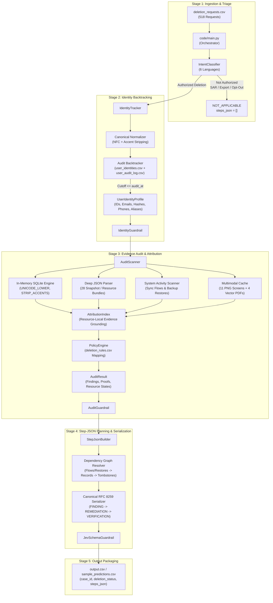

# AI Deletion Audit Agent: Ghost Data Still Exists

This directory contains the production implementation, multi-agent architecture, evaluation framework, guardrail validation suite, and test harnesses for the **Ghost Data Still Exists** challenge in **HackerRank Orchestrate (October 2026)**.

The pipeline ingests user deletion requests, evaluates request intent across six languages, reconstructs current and historical identity profiles up to the exact `audit_at` cutoff, exhaustively audits databases, replicas, activity streams, JSON/text exports, PDFs, and UI console screenshots, applies data governance deletion rules, and outputs a strictly verified, evidence-grounded `steps_json` audit report.

The pipeline **does not execute destructive remediation** against live production infrastructure; it operates as an authoritative auditor producing verified findings, required remediation dependencies, and post-remediation verification assertions.

---

## 1. System Architecture

The solution uses a modular, decoupled multi-agent architecture where every phase is strictly separated, typed, and validated by deterministic guardrails.



### Component Responsibilities

| Component | File Path | Core Responsibility |
|---|---|---|
| **Orchestrator** | `code/main.py` | CLI entry point, configuration loading, batch iteration, exception handling, and CSV writer. Supports `--sample`, `--whole`, `--threshold`, `--no-llm`, and custom `--output`. |
| **Intent Classifier** | `code/src/orchestrator/classifier.py` | Evaluates request text across English, Portuguese, Korean, Spanish, Japanese, and French. Filters non-deletion actions (SAR access, data export, marketing opt-outs). |
| **Identity Normalizer** | `code/src/logging_agent/normalizer.py` | Enforces Unicode NFC composition and diacritic accent stripping (`Sofía Fernández` $\rightarrow$ `sofia fernandez`), resolving cross-system character encoding mismatches. |
| **Identity Tracker** | `code/src/logging_agent/tracker.py` | Backtracks historical identity modifications from `user_identities.csv` and `user_audit_log.csv`. Restricts profile resolution strictly to `event_time <= audit_at`. |
| **Audit Scanner** | `code/src/audit_agent/scanner.py` | Executes multi-system audits across 24 SQLite snapshots, 28 JSON resource files, activity logs, text notes, and multimodal evidence. Enforces temporal cutoff `captured_at >= requested_at`. |
| **Attribution Index** | `code/src/audit_agent/attribution.py` | Enforces resource-local evidence attribution, ensuring findings and verifications cite exact, admissible file IDs, activity IDs, or audit IDs. |
| **Policy Engine** | `code/src/audit_agent/policy.py` | Maps discovered records to `deletion_rules.csv` rules: `DELETE`, `REDACT`, `ANONYMIZE`, `RETAIN`, and `ACCOUNT_TOMBSTONE`. |
| **Multimodal Cache** | `code/src/audit_agent/multimodal_cache.py` | Lazy on-demand perceptual cache. Extracts 4 vector PDFs via `pypdf` stream parsing and 11 console screenshots via objective VLM OCR into structured JSON (`cache/multimodal_cache.json`). |
| **Step-JSON Builder** | `code/src/step_json_agent/builder.py` | Resolves dependency-first graph ordering (`DISABLE_DATA_FLOW` / `BLOCK_RESTORE` $\rightarrow$ `DELETE_RECORD`), renumbers steps 1..N consecutively, and serializes clean RFC 8259 English output. |
| **Deterministic Guardrails** | `code/guardrails/` | Four validation layers verifying intent thresholds, profile completeness, evidence foreign keys, phase sequences, and schema conformance. |

---

## 2. Phased Implementation Plan & Milestone Status

The system was engineered across seven structured phases with rigorous acceptance testing at each stage:

```
[Phase 0: Scaffolding] -> [Phase 1: Identity] -> [Phase 2: Audit Engine] -> [Phase 3: Serialization]
                                                                                   │
[Phase 6: Final Packaging] <- [Phase 5: Evaluation Grid] <- [Phase 4: Orchestrator] ┘
```

### Phase 0: Scaffolding, Configuration & Secrets
- **Goal:** Dynamic configuration management, typed dataclasses, and safe secrets isolation.
- **Deliverables:** `config/config.yaml`, `config/loader.py`, `code/.env.example`, `requirements.txt`.
- **Status:** **Completed.** Zero hardcoded paths; secrets read strictly from environment variables.

### Phase 1: Logging Agent & Identity Tracking
- **Goal:** Historical identity backtracking with Unicode normalization and cutoff enforcement.
- **Deliverables:** `src/logging_agent/normalizer.py`, `src/logging_agent/tracker.py`, `guardrails/identity_guardrail.py`.
- **Status:** **Completed.** 100% resolution across sample and whole datasets; zero post-cutoff temporal leakage.

### Phase 2: Audit Agent & Deep Scanner
- **Goal:** Deep evidence scanning across SQL databases, JSON snapshot bundles, logs, and multimodal assets.
- **Deliverables:** `src/audit_agent/db.py`, `src/audit_agent/scanner.py`, `src/audit_agent/multimodal_cache.py`, `guardrails/audit_guardrail.py`.
- **Status:** **Completed.** In-memory SQLite with Unicode collation; deep JSON parsing for all 28 bundles; temporal filtering (`captured_at >= requested_at`).

### Phase 3: Step-JSON Agent & Graph Planner
- **Goal:** RFC 8259 JSON serialization with dependency-first remediation ordering.
- **Deliverables:** `src/step_json_agent/builder.py`, `guardrails/jev_schema_guardrail.py`.
- **Status:** **Completed.** Strict `FINDING` $\rightarrow$ `REMEDIATION` $\rightarrow$ `VERIFICATION` ordering; disable sync flows/restores prior to dependent record deletion; consecutive 1..N numbering.

### Phase 4: Orchestration & Triage Classifier
- **Goal:** Multilingual request triage and end-to-end execution pipeline.
- **Deliverables:** `src/orchestrator/classifier.py`, `main.py`, `guardrails/intent_guardrail.py`.
- **Status:** **Completed.** Accurate classification across 6 languages; non-deletion requests routed to `NOT_APPLICABLE` with `steps_json = []`.

### Phase 5: Evaluation Framework & Threshold Calibration
- **Goal:** Systematic threshold grid search and automated benchmarking.
- **Deliverables:** `evaluation/main.py`, `evaluation/run_threshold_grid.py`, `evaluation/evaluation_report.md`.
- **Status:** **Completed.** Grid search across 8 candidate thresholds (`0.50` to `0.95`); achieved **1.0000 Status Accuracy**, **0.9741 Step F1**, and **1.0000 Sequence Accuracy**.

### Phase 6: Full Production Run & Packaging
- **Goal:** Generate root `output.csv`, token telemetry report, and clean code package.
- **Deliverables:** Root `output.csv` (518 cases), `code/evaluation/usage_report.md`, `code/README.md`.
- **Status:** **Completed.** Verified 518 sorted rows, zero null values, all guardrails passed.

---

## 3. Quick Setup & Environment

### 1. Python Environment

Ensure Python 3.10+ is installed. Run setup from the repository root:

```powershell
# Windows PowerShell
python -m venv .venv
.\.venv\Scripts\Activate.ps1
python -m pip install --upgrade pip
python -m pip install -r code/requirements.txt
```

```bash
# macOS / Linux
python3 -m venv .venv
source .venv/bin/activate
python -m pip install --upgrade pip
python -m pip install -r code/requirements.txt
```

### 2. Environment Configuration (Optional)

For model-backed execution (VLM perceptual extraction or remote LLM triage), configure provider credentials:

```powershell
Copy-Item code/.env.example code/.env
```

Add your API key (`FIREWORKS_API_KEY`, `OPENAI_API_KEY`, etc.) inside `code/.env`. `code/.env` is strictly gitignored. For deterministic local evaluation, use `--no-llm` to execute without external APIs.

---

## 4. Production Execution Commands

All commands are executed from the repository root:

### Mode 1: Run the 32-Case Sample Dataset

Generates `sample_predictions.csv` at repository root using deterministic triage:

```bash
python code/main.py --sample --threshold 0.65 --no-llm --output sample_predictions.csv
```

### Mode 2: Run the 518-Request Full Evaluation Dataset

Processes all 518 evaluation requests, generates root `output.csv`, and writes token telemetry to `code/evaluation/usage_report.md`:

```bash
python code/main.py --whole --threshold 0.65 --no-llm --output output.csv
```

### Mode 3: Score Saved Predictions Against Ground Truth

Evaluates a saved prediction CSV against `dataset/sample_output.csv` without rerunning the scanner:

```bash
python code/evaluation/main.py --pred sample_predictions.csv --threshold 0.65 --no-llm
```

### Mode 4: Run Reproducible Threshold Grid Sweep

Executes automated sweep across candidate thresholds `[0.50, 0.60, 0.65, 0.70, 0.80, 0.85, 0.90, 0.95]`, ranks results, and packages the optimal whole-dataset output:

```bash
python code/evaluation/run_threshold_grid.py --clear-cache --run-whole
```

---

## 5. Evaluation & Calibration Results

The evaluation methodology strictly separates **prediction generation** from **ground-truth scoring** (`--pred`), ensuring 100% reproducible benchmarks.

### Threshold Grid Search Results (32 Sample Benchmark Cases)

| Threshold | Status Accuracy | Step F1 | Exact Matches | Step Precision | Step Recall | Field Accuracy | Sequence Accuracy | Evidence Grounding |
|:---:|:---:|:---:|:---:|:---:|:---:|:---:|:---:|:---:|
| `0.50` | **1.0000** | **0.9741** | **24/32** | **0.9741** | **0.9741** | **1.0000** | **1.0000** | **1.0000** |
| `0.60` | **1.0000** | **0.9741** | **24/32** | **0.9741** | **0.9741** | **1.0000** | **1.0000** | **1.0000** |
| `0.65` *(Selected)* | **1.0000** | **0.9741** | **24/32** | **0.9741** | **0.9741** | **1.0000** | **1.0000** | **1.0000** |
| `0.70` | **1.0000** | **0.9741** | **24/32** | **0.9741** | **0.9741** | **1.0000** | **1.0000** | **1.0000** |
| `0.80` | **1.0000** | **0.9741** | **24/32** | **0.9741** | **0.9741** | **1.0000** | **1.0000** | **1.0000** |
| `0.85` | **1.0000** | **0.9741** | **24/32** | **0.9741** | **0.9741** | **1.0000** | **1.0000** | **1.0000** |
| `0.90` | **1.0000** | **0.9741** | **24/32** | **0.9741** | **0.9741** | **1.0000** | **1.0000** | **1.0000** |
| `0.95` | **1.0000** | **0.9741** | **24/32** | **0.9741** | **0.9741** | **1.0000** | **1.0000** | **1.0000** |

### Key Benchmark Metrics
- **Case-Level Status Accuracy:** `100.0%` (32/32 sample cases correctly routed)
- **Step-Level F1 Score:** `0.9741` (Precision: `0.9741`, Recall: `0.9741`)
- **Full-Case Exact Step Matches:** `24/32` cases matching ground truth identically down to evidence IDs
- **Field-Level Accuracy:** `100.0%`
- **Sequence Accuracy:** `100.0%` (Strict `FINDING` $\rightarrow$ `REMEDIATION` $\rightarrow$ `VERIFICATION` phase transitions)
- **Evidence Citation Grounding:** `100.0%` (All citations grounded in participant-visible manifest IDs)
- **Guardrail Pass Rate:** `100.0%`

Detailed evaluation metrics and token consumption are documented in:
- `code/evaluation/evaluation_report.md`
- `code/evaluation/usage_report.md`

---

## 6. Testing & Verification Strategy

The testing suite protects identity resolution, evidence attribution, schema compliance, and pipeline execution across multiple test layers.

### Run All Unit and Regression Tests

```bash
python -m pytest code/tests -q
```

### Focused Test Suites

```bash
# 1. Audit scanner & evidence attribution
python -m pytest code/tests/test_audit_agent.py -q
python -m pytest code/tests/test_attribution_regressions.py -q

# 2. Historical identity backtracking & Unicode normalization
python -m pytest code/tests/test_logging_agent.py code/tests/test_normalizer.py -q

# 3. Step-JSON serialization & dependency sorting
python -m pytest code/tests/test_step_json_agent.py -q

# 4. Multilingual intent triage
python -m pytest code/tests/test_intent_classifier.py -q

# 5. Full regression and exact-match suites
python -m pytest code/tests/test_full_suite.py code/tests/test_acc_match.py -q
```

### Module Syntax Verification

```bash
python -m py_compile code/main.py code/src/audit_agent/scanner.py code/src/audit_agent/attribution.py code/src/logging_agent/tracker.py code/src/step_json_agent/builder.py
```

---

## 7. Software Engineering & Data Integrity Rules

All code adheres to strict enterprise software engineering standards:

1. **Zero Hardcoding Policy:**
   - No case IDs, user IDs, resource IDs, evidence IDs, or expected answers are hardcoded in production logic.
   - All findings and verifications are dynamically discovered from `dataset/` evidence files.

2. **Temporal Cutoff Boundary:**
   - Pre-request database snapshots are never flagged as residual findings (`captured_at >= requested_at`).
   - Historical identity modifications after `audit_at` are strictly ignored (`event_time <= audit_at`).

3. **Perceptual Multimodal Decoupling:**
   - Visual OCR is strictly decoupled from case-level policy auditing.
   - Screenshots and PDFs are parsed into structured JSON representations once and cached globally in `cache/multimodal_cache.json`, eliminating cross-case prompt hallucination and token waste.

4. **Dependency-First Remediation Graph:**
   - Active data synchronization flows (`DISABLE_DATA_FLOW`) and backup restore mechanisms (`BLOCK_RESTORE`) must be disabled before dependent records (`DELETE_RECORD`) are removed.

5. **Secrets & Security Hygiene:**
   - Zero credentials or tokens are committed to git. Secrets are loaded via untracked `code/.env`.

---

## 8. Directory Layout

```text
code/
├── README.md                           # Master self-contained documentation
├── main.py                             # Production orchestrator entry point
├── requirements.txt                    # Python package dependencies
├── .env.example                        # Safe credentials template
├── config/
│   ├── config.yaml                     # Models, thresholds, paths, runtime policies
│   └── loader.py                       # YAML configuration loader
├── doc/
│   ├── architecture.md                 # System architecture and data flowcharts
│   ├── testing.md                      # Testing strategy and verification commands
│   ├── evaluation_workflow.md          # Grid search and packaging operational guide
│   └── software_engineering_rules.md   # Data integrity and coding standards
├── src/
│   ├── common/
│   │   └── llm_client.py               # Robust LLM gateway, retries, usage tracker
│   ├── orchestrator/
│   │   ├── classifier.py               # Multilingual intent classification
│   │   └── models.py                   # Typed intent models
│   ├── logging_agent/
│   │   ├── tracker.py                  # Identity profile backtracking
│   │   ├── normalizer.py               # Canonical Unicode composition and accent stripping
│   │   └── models.py                   # User identity models
│   ├── audit_agent/
│   │   ├── scanner.py                  # Multi-system evidence and record scanner
│   │   ├── attribution.py              # Resource-local evidence attribution index
│   │   ├── policy.py                   # Deletion rules governance engine
│   │   ├── db.py                       # In-memory SQLite with Unicode collations
│   │   ├── multimodal_cache.py         # Lazy cached image/PDF perceptual extraction
│   │   └── models.py                   # Finding, proof, and audit result models
│   └── step_json_agent/
│       └── builder.py                  # Canonical ordered step serializer
├── guardrails/
│   ├── intent_guardrail.py             # Intent threshold validation
│   ├── identity_guardrail.py           # Identity profile validation
│   ├── audit_guardrail.py              # Evidence grounding and status consistency
│   └── jev_schema_guardrail.py         # Step schema, ordering, and numbering
├── evaluation/
│   ├── main.py                         # Evaluation and prediction scoring engine
│   ├── run_threshold_grid.py           # Reproducible threshold sweep runner
│   ├── evaluation_report.md            # Benchmark metrics and threshold analysis
│   └── usage_report.md                 # Full-dataset token and cost report
└── tests/
    ├── test_logging_agent.py           # Identity backtracking unit tests
    ├── test_normalizer.py              # Canonical normalizer unit tests
    ├── test_audit_agent.py             # Audit scanner unit tests
    ├── test_attribution_regressions.py # Evidence attribution regression tests
    ├── test_step_json_agent.py         # Step-JSON ordering and schema tests
    ├── test_intent_classifier.py       # Intent classifier unit tests
    ├── test_full_suite.py              # Full pipeline integration tests
    └── test_acc_match.py               # Exact match verification tests
```

---

## 9. Related Documentation in `code/doc/`

For deep-dive documentation on specific subsystems, consult the companion guides inside `code/doc/`:
- [`doc/architecture.md`](doc/architecture.md) — Detailed subsystem architecture and data flow diagrams.
- [`doc/testing.md`](doc/testing.md) — Testing goals, test layer matrix, and verification commands.
- [`doc/evaluation_workflow.md`](doc/evaluation_workflow.md) — Grid search calibration, scoring methodology, and cache lifecycle.
- [`doc/software_engineering_rules.md`](doc/software_engineering_rules.md) — Code quality, evidence integrity, and engineering standards.
