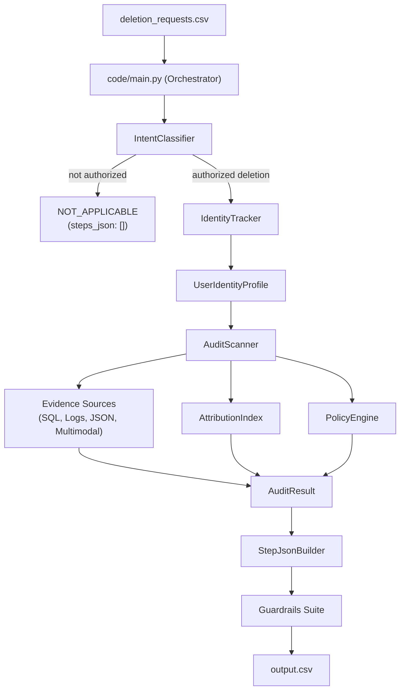

# AI Deletion Audit Agent: System Architecture

## 1. Purpose and operating boundary

The deletion-audit agent investigates whether a customer's personal data is actually gone at a requested point in time. It scans participant-supplied evidence, reconstructs current and historical identifiers, applies `dataset/deletion_rules.csv`, and emits an auditable result.

The agent **does not delete data itself**. Remediation steps are proposed operations such as `DELETE_RECORD`, `REDACT_RECORD`, `ANONYMIZE_RECORD`, `DISABLE_DATA_FLOW`, and `BLOCK_RESTORE`. A human or downstream workflow must execute those operations.

The production entry point is `code/main.py`:


## 2. Runtime flow



## 3. Components and responsibilities

### 3.1 Orchestration and intent

| Module | Responsibility |
|---|---|
| `code/main.py` | Loads configuration, chooses sample/whole input, accepts a per-run threshold and model mode, runs cases sequentially, and writes prediction CSVs. |
| `code/src/orchestrator/classifier.py` | Applies explicit non-deletion guards, then optional local decision model, optional configured LLM/VLM, and deterministic multilingual fallback rules. |
| `code/src/orchestrator/models.py` | Defines the typed intent result passed to the guardrail and orchestrator. |
| `code/config/loader.py` | Loads YAML configuration and supported environment overrides such as `INTENT_THRESHOLD`. |

Non-deletion requests short-circuit to `NOT_APPLICABLE` with `[]`. A deletion keyword alone is not sufficient when the same request explicitly says to retain the account or asks only for export, access, correction, or marketing opt-out.

### 3.2 Identity reconstruction

`code/src/logging_agent/tracker.py` builds `UserIdentityProfile` from:

- the current row in `user_identities.csv`;
- historical `old_value` and `new_value` fields in `user_audit_log.csv`;
- only audit events at or before `audit_at`;
- normalized current and historical emails, phones, names, and email hashes.

The profile is the scanner's subject signature. It is case-insensitive and Unicode-aware, but it must remain bounded by the case cutoff. The identity guardrail rejects missing users, empty search signatures, and post-cutoff audit events.

### 3.3 Evidence scanning

`code/src/audit_agent/scanner.py` combines several evidence channels:

1. **Logs** — line-oriented and JSON-style logs, including trace correlation. Resource state is determined from resource-local fields such as `rows=0`, `enabled=true`, `restore_allowed=false`, or direct-identifier markers.
2. **Text handovers** — pipe-delimited records with system, resource, category, and state.
3. **SQL snapshots** — SQLite-compatible exports. Residual findings use captures at or after `requested_at`; historical captures can still provide context or compliant proofs.
4. **JSON exports and snapshot bundles** — service exports are matched by user ID, email, historical email, or email hash. Inner snapshot timestamps are honored when the outer bundle was exported later.
5. **PDF and image evidence** — read through `LazyMultimodalCache`; PDF text is extracted locally and screenshots use the configured image extractor when available.
6. **System activity** — active `CHECK_DATA_FLOW` and `CHECK_RESTORE_ACCESS` events are risks, while successful disable/block actions can support verification targets.

The scanner distinguishes direct evidence from inferred attribution. Direct evidence may create findings. An orphan worker action may supply a verification target only after bounded ownership, timing, and resource-local checks.

### 3.4 Attribution and ownership

`code/src/audit_agent/attribution.py` indexes:

- user signatures from current and historical identity data;
- resource-to-file and file-to-user observations;
- deletion-worker actions and their timestamps;
- bounded report-time batches for resources with no direct identifier.

Attribution is intentionally conservative. A resource is not assigned merely because it appears in the same broad export. Resource-local ownership, co-observed files, operation timing, report status, and one-resource-per-prefix constraints are used to prevent cross-case leakage.

### 3.5 Policy and state model

`PolicyEngine` maps a resource prefix/system to a policy category and reads the required action from `deletion_rules.csv`.

Typical categories are:

| Category | Required treatment |
|---|---|
| `USER_PROFILE`, `SEARCH_INDEX_ENTRY`, `USER_EXPORT` | Delete. |
| `SUPPORT_ATTACHMENT` | Delete when subject-only; shared conversations may be redacted. |
| `ANALYTICS_PROFILE`, `PRODUCT_TELEMETRY` | Anonymize when attributable. |
| `ACCOUNT_TOMBSTONE` | Redact direct identifiers while retaining stable references when allowed. |
| `SECURITY_AUDIT_LOG`, `LEGAL_HOLD_RECORD` | Retain when the supplied rule requires it. |
| `BACKUP_ARCHIVE` | Retain only when restore access is blocked. |
| `CONNECTOR_DATA_FLOW` | Disable. |

An audit is `INCOMPLETE` when any in-scope residual record, exposed identifier, active flow, or restore risk remains. It is `COMPLETE` only when no finding remains and the result contains evidence-backed verification proofs.

### 3.6 Step serialization

`code/src/step_json_agent/builder.py` converts an `AuditResult` into the required ordered array:

- `NOT_APPLICABLE`: `[]`;
- `COMPLETE`: verification steps only, with evidence IDs;
- `INCOMPLETE`: findings, proposed remediations, then future verifications.

The builder sorts by phase, operation priority, `system_id`, and `resource_id`, then renumbers from 1. Proposed remediation and future verification steps use an empty `evidence_id` because they describe target state rather than observed state.

## 4. Guardrails and failure boundaries

Guardrails live in `code/guardrails/`:

| Guardrail | Main checks |
|---|---|
| `IntentGuardrail` | Intent result shape, confidence, and threshold consistency. |
| `IdentityGuardrail` | Resolved user, non-empty identifiers, and cutoff compliance. |
| `AuditGuardrail` | Allowed operations, non-empty finding evidence, and complete-case proof requirements. |
| `StepJsonGuardrail` | JSON shape, operation enums, phase ordering, numbering, and evidence rules. |

The main loop logs guardrail failures and continues according to the configured stop policy.
When a case cannot produce a trustworthy audit result, it emits an `INCOMPLETE` row with an
empty step array rather than dropping the request. This preserves one output row per input
without inventing a resource or citation.

## 5. Caching and reproducibility

`LazyMultimodalCache` stores extraction results by `file_id` in `cache/multimodal_cache.json`. Cache entries include the source path, capture time, origin, format, raw text, and structured records. Cache reads must not mix evidence between cases; the scanner still applies case identity and timestamp filters after loading a cached extraction.

The threshold workflow clears this runtime extraction file at most once before a fresh
experiment and reuses it across candidate thresholds. Threshold changes affect intent
authorization, not the underlying evidence extraction, so clearing the cache between every
candidate would add cost without improving correctness. A parser or extraction change is a
reason to clear it once and repeat the whole experiment.

Configuration is read from `code/config/config.yaml`. Secrets such as `FIREWORKS_API_KEY` are loaded from environment variables or a local untracked `code/.env` file.

## 6. Evaluation and outputs

`code/evaluation/main.py` evaluates the 32-case sample against `dataset/sample_output.csv` and records metrics in `evaluation/evaluation_history.jsonl`. Its `--pred` mode scores an already-generated prediction CSV and therefore does not rerun the pipeline. `code/evaluation/run_threshold_grid.py` runs the production pipeline once per candidate threshold, scores every saved prediction, writes `evaluation/evaluation_report.md`, and can package the whole dataset at the selected threshold.

The standard deterministic workflow is:

```text
run_threshold_grid.py
  -> code/main.py --sample --threshold T --no-llm
  -> evaluation/threshold_runs/threshold_T/sample_predictions.csv
  -> code/evaluation/main.py --pred saved_predictions.csv
  -> evaluation/evaluation_report.md
  -> code/main.py --whole --threshold selected_T --no-llm
  -> output.csv
```

The configured threshold, currently `0.65`, is a baseline rather than a hardcoded truth. The
report ranks measured candidates by status accuracy, step F1, full-case exact matches, and
evidence grounding. If the baseline ties for best, the report says so explicitly.

The most important invariants are:

1. every input case receives exactly one output row;
2. non-deletion requests receive `NOT_APPLICABLE` and `[]`;
3. every finding cites a real manifest/activity/audit evidence ID;
4. complete cases contain only evidence-backed verification steps;
5. step numbers are consecutive and phase order is valid;
6. no identity or evidence event after `audit_at` is used to prove the audited state.
