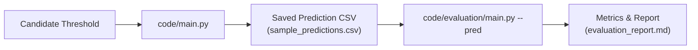

# Evaluation, Threshold Selection, and Packaging Workflow

This document is the operational guide for producing a reproducible sample score and the
final whole-dataset `output.csv`. It explains why a threshold is selected, how the pipeline
and evaluator are connected, what the cache contains, and which files should be retained.

## 1. The problem this workflow solves

An evaluation is only meaningful when the evaluator scores the exact predictions that were
generated by the pipeline. Running the pipeline once and then asking the evaluator to run it
again can produce different results when a model is enabled, when a model service is
unavailable, or when a lazy evidence extractor has different cache state.

The maintained workflow therefore separates **generation** from **scoring**:



The evaluator's `--pred` mode never reruns the scanner. It parses the saved CSV and compares
it with `dataset/sample_output.csv`.

## 2. Acceptance criteria

A valid evaluation run must satisfy all of the following:

1. Every sample request produces one prediction row.
2. The saved prediction has the columns `case_id`, `deletion_status`, and `steps_json`.
3. `dataset/sample_output.csv` remains unchanged and is used only as gold truth.
4. Every threshold result is saved separately before scoring.
5. The report contains every tested threshold and the measured metrics.
6. The selected threshold is explained from the measured results.
7. The selected sample prediction is copied to root `sample_predictions.csv`.
8. The selected threshold is used for the whole dataset, producing root `output.csv`.
9. Cache reuse does not change the evidence contract or mix records between cases.

## 3. Threshold semantics

The intent threshold is a value in `[0, 1]`. The classifier uses it when deciding whether a
request is authorized for deletion. It does not directly change resource attribution,
evidence parsing, remediation policy, or step ordering.

The configured baseline is stored in `code/config/config.yaml`:

```yaml
thresholds:
  intent_decision: 0.65
  grid_search_candidates: [0.50, 0.60, 0.65, 0.70, 0.80, 0.85, 0.90, 0.95]
```

`0.65` is not treated as a magic constant. It is the current operating baseline. The grid
workflow tests it against the other configured candidates. A threshold is ranked by:

1. status accuracy;
2. step F1;
3. full-case exact matches, including evidence IDs;
4. evidence-grounding accuracy.

If the configured baseline is tied for the best measured result, the workflow keeps `0.65`
and records that it is a measured tie. If it is not tied for best, the report names the
threshold selected by the ranking. This makes the explanation auditable instead of claiming
that `0.65` is inherently optimal.

## 4. Deterministic evaluation mode

The default threshold-grid command uses deterministic triage fallbacks by passing
`--no-llm` to the production pipeline. This is the recommended mode for benchmark scoring
because repeated runs should produce the same prediction file.

Run the complete sweep and whole-dataset packaging from the repository root:

```powershell
python code/evaluation/run_threshold_grid.py --clear-cache --run-whole
```

The command:

1. optionally removes only `cache/multimodal_cache.json`;
2. runs `code/main.py --sample --threshold ... --no-llm` once for every candidate;
3. saves each prediction CSV under `evaluation/threshold_runs/`;
4. scores each saved CSV with the same evaluator logic;
5. selects the best measured threshold;
6. copies that sample prediction to `sample_predictions.csv`;
7. runs `code/main.py --whole` at the selected threshold;
8. validates root `output.csv` row count, columns, JSON, and ordering;
9. writes all threshold results to `evaluation/evaluation_report.md`.

To test a custom grid:

```powershell
python code/evaluation/run_threshold_grid.py --clear-cache --run-whole --thresholds 0.50 0.60 0.65 0.70 0.80
```

To test the configured model instead of deterministic fallback behavior, opt in explicitly:

```powershell
python code/evaluation/run_threshold_grid.py --with-llm --clear-cache
```

Model-backed results must be treated as a separate experiment. Do not compare them with a
deterministic run without recording the mode in the report.

## 5. Manual one-threshold workflow

The following commands are useful when investigating one threshold:

```powershell
python code/main.py --sample --no-llm --threshold 0.65 --output sample_predictions.csv
python code/evaluation/main.py --pred sample_predictions.csv --threshold 0.65 --no-llm
```

`--pred` is the important part. Without it, `code/evaluation/main.py --threshold 0.65`
will execute the pipeline again, which is useful for legacy comparison but not for an exact
saved-run score.

## 6. Cache lifecycle

The runtime cache is `cache/multimodal_cache.json`. It stores lazy extraction results for
PDF and image evidence keyed by `file_id`. It is not a prediction cache and it must not be
used to bypass case identity or timestamp checks.

### Safe rules

- Clear the runtime cache once before a fresh experiment when testing extraction changes.
- Reuse the same cache across thresholds in one sweep; threshold changes do not change the
  underlying evidence extraction.
- Never clear the cache between thresholds unless the experiment is specifically testing
  extraction invalidation.
- Never delete `dataset/sample_output.csv`; it is the supplied reference output.
- The scanner still applies case-specific identity and `audit_at` filters after a cache hit.
- Cache entries include source path, capture time, origin, format, raw text, and records.

`run_threshold_grid.py --clear-cache` removes only the runtime extraction file. It does not
delete the dataset, the reference output, threshold artifacts, or documentation.

## 7. Output layout

After a normal deterministic sweep, the important files are:

| Path | Meaning |
|---|---|
| `dataset/sample_output.csv` | Supplied gold truth; never overwrite. |
| `sample_predictions.csv` | Selected threshold's sample predictions. |
| `evaluation/threshold_runs/threshold_0_50/sample_predictions.csv` | Predictions for one candidate. |
| `evaluation/threshold_runs/threshold_0_50/pipeline.log` | Pipeline log for that candidate. |
| `evaluation/threshold_grid_history.jsonl` | Machine-readable result for every candidate. |
| `evaluation/evaluation_report.md` | Human-readable threshold comparison and selection rationale. |
| `evaluation/whole_pipeline.log` | Whole-dataset pipeline log. |
| `output.csv` | Final selected-threshold output for all requests. |
| `evaluation/usage_report.md` | Usage report generated by whole-dataset execution. |

## 8. Whole-dataset output contract

The final root `output.csv` must contain exactly:

```text
case_id,deletion_status,steps_json
```

It must contain one row for every row in `dataset/deletion_requests.csv`, preserve numeric
case ordering, and contain valid JSON arrays in every `steps_json` cell. `NOT_APPLICABLE`
rows must contain `[]`. Findings must cite evidence; proposed remediation and future
verification targets use an empty evidence ID.

If identity or audit guardrails prevent a case from producing a trustworthy plan, the
orchestrator records that request as `INCOMPLETE` with an empty step array and logs the
guardrail error. It does not silently drop the row. This preserves the one-row-per-request
packaging contract without fabricating evidence or remediation steps.

The threshold grid runner validates these conditions after the whole run. A failed
validation stops the workflow instead of reporting a successful package.

## 9. How to read the report

Start with **Threshold selection**. It identifies:

- the configured baseline;
- the selected threshold;
- whether the baseline tied for the best result;
- the exact ranking criteria.

Then inspect **All threshold results**. A high status score with low step F1 indicates that
intent routing is good but evidence/resource planning is still weak. A high step F1 with
lower status accuracy indicates that the scanner is strong after authorization, but the
intent boundary needs attention. A lower evidence-grounding score indicates that findings
or complete-case proofs are citing the wrong or missing evidence.

Finally inspect **Whole-dataset packaging** to confirm that the final output was generated
with the selected threshold and that its row/JSON checks passed.

## 10. Troubleshooting

### Different counts between pipeline and evaluator

Use a saved prediction file:

```powershell
python code/main.py --sample --no-llm --threshold 0.65 --output sample_predictions.csv
python code/evaluation/main.py --pred sample_predictions.csv --threshold 0.65 --no-llm
```

Do not compare two commands that each rerun the model-backed pipeline.

### A threshold result changes after an evidence parser edit

Clear `cache/multimodal_cache.json` once, rerun the complete sweep, and keep the new logs.
Do not clear the cache separately for each threshold.

### A threshold appears tied

Read the report's selection reason. A tie means the measured sample cannot distinguish the
candidates. Keep the configured baseline unless new validation data provides a reason to
change it.

### Root `output.csv` has the wrong row count

Inspect `evaluation/whole_pipeline.log`, confirm that the whole mode was used, and rerun
the packaging step after fixing the first reported failure. Do not silently fill missing
rows with fabricated results.
