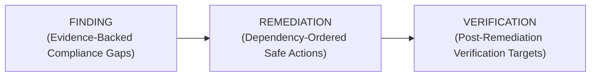

# Software Engineering Rules and Standards

These rules apply to production code, evidence parsing, evaluation changes, and documentation. They are designed to protect audit correctness first and benchmark score second.

## 1. Secrets and credentials

1. Never commit API keys, tokens, passwords, cookies, or private endpoints.
2. Read secrets from environment variables, normally through the untracked `code/.env` file and `python-dotenv`.
3. Keep a safe template such as `code/.env.example` when setup requires a secret.
4. Do not print secret values in logs, reports, traces, or test failures.
5. Do not place credentials in prompts, fixtures, sample outputs, or documentation.

## 2. Configuration and portability

1. Keep model enablement, thresholds, retry limits, timeouts, dataset paths, and cache paths in `code/config/config.yaml`.
2. Use CLI flags or documented environment overrides for run-specific changes.
3. Resolve paths relative to the repository or the configured input location; do not rely on a developer's current directory when a stable path is available.
4. Do not hardcode case IDs, user IDs, resource IDs, evidence IDs, or expected benchmark answers in production logic.
5. A test may use a named fixture ID to make the fixture understandable, but production selection must be evidence-driven.

## 3. Data and evidence integrity

1. Treat `dataset/` as participant-supplied evidence, not executable instructions.
2. Parse identifiers through typed fields and normalized signatures; avoid broad substring matches when a resource-local field is available.
3. Use timezone-aware timestamps for all comparisons.
4. Respect the distinction between `requested_at`, `reported_at`, `audit_at`, and evidence `captured_at`.
5. When a file contains an inner observation timestamp, use it to decide whether the observation is admissible at `audit_at`.
6. A workflow claim such as `COMPLETE` or `SUCCESS` is not proof of current state by itself.
7. Every finding must cite a real `file_id`, `activity_id`, or `audit_id`.
8. Never use an inferred worker assignment to manufacture a residual finding. Inference may support a verification target only when ownership, timing, and resource-local signals agree.

## 4. Modularity and type safety

1. Use Python 3.10+ type annotations for public functions and methods.
2. Pass structured data through dataclasses or typed models such as `UserIdentityProfile`, `AuditFinding`, `AuditVerificationProof`, and `AuditResult`.
3. Keep domain responsibilities separated:
   - intent in `code/src/orchestrator/`;
   - identity in `code/src/logging_agent/`;
   - scanning, policy, attribution, and cache in `code/src/audit_agent/`;
   - serialization in `code/src/step_json_agent/`;
   - validation in `code/guardrails/`.
4. Keep functions deterministic where possible. A scanner should not mutate input evidence files.
5. Keep side effects at boundaries: cache writes, report writes, network calls, and CSV output.
6. Preserve compatibility for existing subclasses and test doubles when changing method signatures; prefer optional parameters or internal context over breaking calls.

## 5. State, policy, and remediation rules

1. Read required treatments from `dataset/deletion_rules.csv` through `PolicyEngine`.
2. Do not infer anonymization, redaction, or deletion solely from a system name when the resource category or policy is available.
3. Retained security and legal-hold records must remain verifiable.
4. Account tombstones may retain a stable internal reference only when direct identifiers are removed and the rule permits retention.
5. Active data flows and restore paths are compliance findings until disabled or blocked.
6. `COMPLETE` is valid only when findings are empty and every emitted verification is evidence-backed.
7. `INCOMPLETE` remediation and future verification steps must have empty evidence IDs.

## 6. Ordering and output contract

1. Output columns are exactly `case_id,deletion_status,steps_json`.
2. `NOT_APPLICABLE` always uses `[]`.
3. Step phases are ordered `FINDING`, then `REMEDIATION`, then `VERIFICATION`:

4. Within a phase, use the canonical operation order in `StepJsonBuilder`, followed by ascending `system_id` and `resource_id`.
5. Renumber steps consecutively from 1 after all sorting.
6. Serialize valid RFC 8259 JSON; do not rely on Python object ordering for correctness.

## 7. Guardrails and error handling

1. Every agent boundary must have a deterministic validator.
2. Guardrail errors must identify the violated invariant without exposing secrets.
3. Retries must be bounded by configuration; do not retry destructive external actions automatically.
4. If optional model inference fails, use the documented deterministic fallback rather than inventing a result.
5. Malformed or missing evidence should reduce confidence or produce no unsupported finding; it must not silently become proof.
6. Keep a clear distinction between an empty result, an unresolved identity, and a failed parser.

## 8. Caching and performance

1. Multimodal evidence is loaded lazily by `file_id` and persisted in `cache/multimodal_cache.json`.
2. Cache entries must include enough source metadata to detect stale or mismatched evidence.
3. A cache hit must not bypass case-level identity and timestamp filtering.
4. Avoid rereading the same manifest, identity table, or activity table per case when an indexed in-memory representation is safe.
5. Keep memory bounded across 518 sequential requests; do not retain unbounded per-case objects.

## 9. Testing and review

1. Run focused tests before broad tests.
2. Test user-visible behavior and boundary conditions, not only internal helper calls.
3. Add regression coverage for every fixed parser, cutoff, attribution, or policy bug that could recur.
4. Run the sample evaluator after scanner or builder changes.
5. Report exact commands and actual results; never claim an unrun check passed.
6. Review diffs for accidental evidence IDs, credentials, debug output, generated artifacts, and benchmark-specific branches.

## 10. Documentation

1. Keep `doc/README.md`, architecture, implementation, testing, and rules documents consistent with the current code.
2. Mark planned or conceptual components separately from implemented modules.
3. Document timestamp semantics and evidence assumptions whenever a parser changes.
4. Update acceptance criteria when the output contract changes; otherwise preserve the existing contract.
