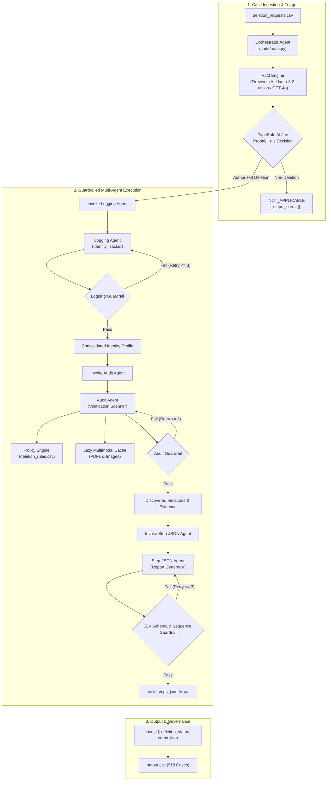

# AI Deletion Audit Agent: System Architecture

## 1. System Overview

The **AI Deletion Audit Agent** is an enterprise-grade multi-agent audit system designed for Northstar Shop to investigate, verify, and remediate customer data deletion requests across distributed databases, search indexes, backups, and data pipelines.

The architecture strictly follows a **Hierarchical Orchestrator-Worker pattern** featuring a **Tandem Model Pipeline**: a high-speed **Vision-Language Model (VLM)** (Fireworks AI Llama-3.2-Vision, Qwen2.5-VL, or GPT-4o via LiteLLM) for multilingual context understanding and screenshot inspection, working alongside **TypeSafe AI Jev** for structured probabilistic compliance decisions, backed by **sub-agent guardrails**, **3-retry exponential backoff loops**, and **lazy on-demand caching**.

---

## 2. Agent Subsystems & Responsibilities

### 2.1. Orchestrator Agent (`code/src/orchestrator/`)
* **Role:** Central mission controller.
* **Responsibilities:**
  1. Sequentially processes cases from `dataset/deletion_requests.csv` without cross-case state contamination.
  2. Evaluates multilingual `request_text` via the VLM Engine (Fireworks AI Llama-3.2-Vision / Qwen2.5-VL / GPT-4o) and passes semantic signals to **TypeSafe AI Jev** to obtain a structured intent decision and calibrated probability score.
  3. Short-circuits non-deletion requests immediately to `NOT_APPLICABLE` with `steps_json = []`.
  4. Manages sub-agent lifecycle: invokes Logging Agent, Audit Agent, and Step-JSON Agent in strict order.
  5. Implements **Retry Loops (2–3 attempts)** with error reflection when a sub-agent output fails its guardrail.

### 2.2. Logging Agent (Identity Tracker) (`code/src/logging_agent/`)
* **Role:** Historical identity reconstruction engine.
* **Responsibilities:**
  1. Performs case-insensitive matching against `dataset/user_identities.csv`.
  2. Backtracks through `dataset/user_audit_log.csv` to uncover historical email addresses, prior phone numbers, and past email hashes.
  3. Enforces the strict timestamp rule: ignores any identity event occurring after `audit_at`.
  4. Returns a typed `UserIdentityProfile` containing all historical and current identifiers.

### 2.3. Audit Agent (Verification Scanner) (`code/src/audit_agent/`)
* **Role:** Multi-system data investigator.
* **Responsibilities:**
  1. Reconstructs actual data presence across 24 `.sql` snapshots using SQLite in-memory execution.
  2. Parses logs and JSON exports for mentions of any user identifier.
  3. Scans `dataset/system_activity.csv` for active sync jobs (`CHECK_DATA_FLOW`) and restore risks (`CHECK_RESTORE_ACCESS`).
  4. Incorporates `dataset/deletion_rules.csv`: distinguishes records requiring full deletion from those requiring retention (`rule_12`, `rule_13`), redaction (`rule_15` tombstones), or anonymization (`rule_07`, `rule_08`).
  5. Interacts with the **Lazy On-Demand Multimodal Cache**: inspects PDFs or PNG console screenshots only if referenced by the case, caching extractions to prevent repeated processing.

### 2.4. Step-JSON Agent (Report Generator) (`code/src/step_json_agent/`)
* **Role:** Deterministic report serializer and validator.
* **Responsibilities:**
  1. Distinguishes `COMPLETE` vs `INCOMPLETE` outputs:
     * **`INCOMPLETE`:** Emits findings (with evidence IDs), proposed remediations (`evidence_id = ""`), and future verifications (`evidence_id = ""`).
     * **`COMPLETE`:** Emits only verification checks, each backed by real evidence proving the compliant state.
  2. Enforces strict phase ordering: `FINDING` $\rightarrow$ `REMEDIATION` $\rightarrow$ `VERIFICATION`.
  3. Sorts operations by canonical priority, breaking ties with ascending `system_id` and `resource_id`.
  4. Assigns continuous step numbers starting at 1.

---

## 3. Guardrails Subsystem (`code/guardrails/`)

Every sub-agent is shielded by an independent, deterministic guardrail:

| Sub-Agent | Guardrail Class | Checks Enforced |
|---|---|---|
| **Logging Agent** | `IdentityGuardrail` | Valid `user_id` resolved; no temporal leakage (all events $\le$ `audit_at`); non-empty identifier set. |
| **Audit Agent** | `AuditEvidenceGuardrail` | All cited evidence IDs exist in manifests; operations match problem statement enum; compliance with `deletion_rules.csv`. |
| **Step-JSON Agent** | `JevSchemaGuardrail` | Valid RFC 8259 JSON; 1..N continuous numbering; phase and operation ordering; empty strings for future remediations. |

If any guardrail check fails, the Orchestrator passes the validation error back to the sub-agent for self-correction (up to a maximum of 3 retries).

---

## 4. Evaluation & Experiment Management (`code/evaluation/`)

The evaluation system in `code/evaluation/main.py`:
1. Executes pipeline against the 32 reference cases in `dataset/sample_deletion_requests.csv`.
2. Compares outputs with `dataset/sample_output.csv` across the 5 evaluation dimensions (Status, Step F1, Fields, Sequence, Evidence).
3. Executes the empirical threshold grid search across $\tau \in [0.50, 0.70, 0.80, 0.85, 0.90, 0.95]$.
4. Automatically maintains a persistent execution log in `code/evaluation/evaluation_history.jsonl` tracking timestamp, commit, threshold, accuracy, and token usage for every evaluation run.
