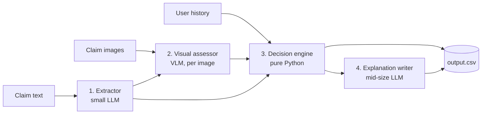

# Multi-Modal Evidence Review Engine

Automated damage-claim verification for cars, laptops and packages, built for the HackerRank Orchestrate hackathon (June 2026).

It reads a customer's claim text, inspects every submitted image with a vision-language model, checks the customer's claim history, and returns a structured, explainable decision, with all business rules enforced in plain Python rather than by an LLM.

---

## How it works



| Layer | Job | Model (default) |
|---|---|---|
| 1. Extractor | Turn the claim text into `{object, object_part, issue_type}` | Amazon Nova Micro |
| 2. Visual assessor | Judge each image: supports, contradicts or insufficient, plus quality, severity and risk flags | Claude Sonnet (Bedrock) |
| 3. Decision engine | Aggregate images, apply risk and escalation rules | None (deterministic Python) |
| 4. Explanation writer | Write two grounded sentences for the audit trail | Llama 3.3 70B |

Models are swappable in `config/providers.yaml`. Structured output is enforced with Pydantic and Instructor, via LiteLLM.

---

## Decision rules

**Image aggregation**
- Contradiction beats support: if any usable image clearly contradicts the claim, the claim is `contradicted`.
- Weak support is discarded: `support_strength < 4` with `acceptable` or `poor` image quality does not count.
- Hallucination guard: if the VLM returns identical text for object, component and issue evidence, that image is ignored.

**Customer risk (`RiskEngine`)**
- 3 or more claims in the last 90 days, or 2 or more past rejections, raises `user_history_risk`.

**Escalation (`DecisionEngine`)**
- A `supported` or `not_enough_information` claim with `user_history_risk` becomes `manual_review_required`.
- Clear contradictions are auto-rejected and are not escalated, so reviewers do not waste time on obvious fraud.

---

## Quick start

```bash
python -m venv .venv
source .venv/bin/activate        # Windows: .venv\Scripts\activate
pip install -r requirements.txt

cp .env.example .env             # add your AWS credentials
```

| Mode | Command | Notes |
|---|---|---|
| Mock | `python code/main.py --env mock` | Offline, $0, uses synthetic fixtures |
| Test | `python code/main.py --env test --cache` | Labeled sample claims, writes `code/evaluation/test_output.csv` |
| Production | `python code/main.py --env production` | Runs `dataset/claims.csv`, writes `output.csv` |

`--cache` stores per-image VLM results in `test_cache/` so repeat runs are instant and free.

Score a test run:

```bash
python code/evaluation/compare.py --pred code/evaluation/test_output.csv --true dataset/test_claim_output.csv
```

---

## Configuration

`config/providers.yaml` sets the model, concurrency and retries for each layer:

```yaml
vlm:
  model: bedrock/arn:aws:bedrock:us-east-1:<ACCOUNT_ID>:inference-profile/us.anthropic.claude-sonnet-4-6
  concurrency: 2
  max_retries: 1

generator:
  model: bedrock/us.meta.llama3-3-70b-instruct-v1:0
  concurrency: 5

extractor:
  model: bedrock/amazon.nova-micro-v1:0
  concurrency: 5
```

To switch provider, change the model string (for example `openai/gpt-4o`). Use `model: mock` to run offline.

---

## Results

Evaluated on 20 labeled sample claims (8 fields each, 160 checks in total).

Overall: 65.6% (105 / 160)

| Field | Accuracy |
|---|---:|
| `object_part` | 90% |
| `evidence_standard_met` | 90% |
| `valid_image` | 80% |
| `claim_status` | 70% |
| `supporting_image_ids` | 70% |
| `issue_type` | 60% |
| `severity` | 40% |
| `risk_flags` | 25% |

| Object | Accuracy |
|---|---:|
| Laptop | 75.0% |
| Car | 62.5% |
| Package | 60.4% |

---

## Output format

`output.csv` has 14 columns:

`user_id`, `image_paths`, `user_claim`, `claim_object`, `evidence_standard_met`, `evidence_standard_met_reason`, `risk_flags`, `issue_type`, `object_part`, `claim_status`, `claim_status_justification`, `supporting_image_ids`, `valid_image`, `severity`

Full enums and definitions are in `problem_statement.md`.

---

## Project layout

```text
config/             providers.yaml, dataset.yaml
code/
  main.py           async pipeline entrypoint
  prompts/          VLM and explanation prompts
  src/
    core/           config, data and image loading
    models/         Pydantic schemas
    tools/          extractor, vlm, risk, decision, explanation engines
  evaluation/       compare.py and benchmark output
  testing/          unit tests and synthetic fixtures
dataset/            claims, user history, evidence requirements, images
planning/           design notes and business rules
```

---

## Testing

```bash
pytest code/testing
python code/main.py --env mock
```
