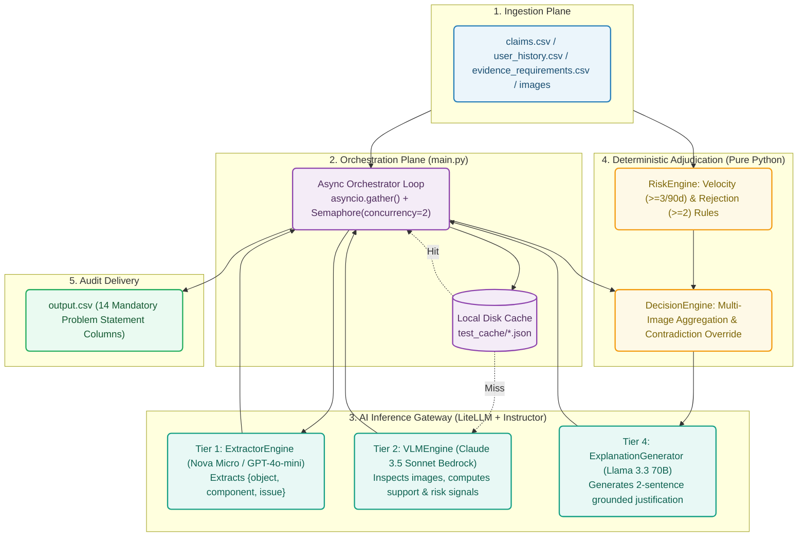

# Code Module Reference: Multi-Modal Evidence Review Engine

This directory contains the core implementation of the multi-modal evidence review pipeline for the HackerRank Orchestrate challenge.

---

## Architecture Overview



The codebase is organized into four distinct operational layers orchestrated asynchronously:

```text
code/
├── main.py                       # CLI Orchestrator (Async event loop, Semaphore rate limiting)
├── prompts/                      # Externalized system prompts
│   ├── vlm_system_prompt.txt     # Object-agnostic visual evaluation instruction
│   └── generator_system_prompt.txt# Two-sentence grounded summary instruction
├── src/
│   ├── core/                     # Infrastructure & configuration
│   │   ├── config.py             # AppConfig (reads .env, providers.yaml, dataset.yaml)
│   │   ├── data_loader.py        # CSV ingestion & row normalization
│   │   └── image_loader.py       # Semicolon path parsing & cross-platform image resolution
│   ├── models/                   # Pydantic schema contracts
│   │   ├── extractor.py          # ExtractorOutput (object, component, issue enums)
│   │   ├── vlm.py                # VLMOutput, VLMReasoning, confidence scores (1-5)
│   │   └── decision.py           # DecisionIntermediateState
│   └── tools/                    # Modular execution engines
│       ├── extractor_engine.py   # Layer 1: Transcript parsing (Amazon Nova Micro / LiteLLM)
│       ├── vlm_engine.py         # Layer 2: Visual assessment (Claude 3.5 Sonnet / LiteLLM)
│       ├── risk_engine.py        # Layer 3: Customer velocity & history risk evaluation
│       ├── decision_engine.py    # Layer 3: Deterministic multi-image evidence aggregation
│       └── explanation_generator.py # Layer 4: Grounded two-sentence explanation synthesis
├── evaluation/                   # Evaluation & accuracy benchmarking
│   ├── compare.py                # Field-by-field accuracy comparison script
│   └── test_output.csv           # Predictions generated on sample benchmark claims
└── testing/                      # Unit, integration, and synthetic tests
    ├── test_decision.py          # Decision engine conflict resolution tests
    ├── test_extractor.py         # Extractor engine tests
    ├── test_generator.py         # Explanation generator tests
    ├── test_image_loader.py      # Path resolution tests
    ├── test_risk_engine.py       # History risk velocity tests
    ├── test_vlm_engine.py        # VLM engine interface tests
    └── synthetic/                # Fixtures for zero-cost offline development ($0 API spend)
        ├── mock_claims.json
        ├── mock_users.json
        └── mock_vlm_data.json
```

---

## Core Pipeline Execution (`code/main.py`)

The pipeline runs with Python's `asyncio` event loop and coordinates the 4 layers:

1. **Risk Ingestion**: Passes the user's historical record to `process_user_risk()`.
2. **Text Extraction**: Asynchronously calls `extractor_engine.extract_claim_details()` to extract `{object, component, issue}`.
3. **Contractual Requirements**: Queries `evidence_requirements.csv` for object/issue rules.
4. **Concurrent VLM Assessment**: Splits multi-image paths (e.g. `img_1.jpg;img_2.jpg`) and queues them across an `asyncio.Semaphore` limit. Results can optionally be cached to disk via `--cache`.
5. **Deterministic Adjudication**: `decision_engine.decide()` aggregates evidence across all images, enforces contradiction overrides, checks quality gates, and resolves risk escalations.
6. **Explanation Generation**: Calls `explanation_generator.generate()` to produce compliant two-sentence justifications.
7. **CSV Output**: Serializes records to the target CSV file (`output.csv` or `test_output.csv`).

### CLI Options

```bash
# Run in Mock mode (Offline, zero cost)
python code/main.py --env mock

# Run against sample benchmark dataset with response caching
python code/main.py --env test --cache

# Run production inference for final submission
python code/main.py --env production
```

---

## Evaluation Harness (`code/evaluation/compare.py`)

Compares model predictions against ground truth across 8 core evaluation fields:
* `object_part`
* `evidence_standard_met`
* `valid_image`
* `issue_type`
* `risk_flags`
* `supporting_image_ids`
* `claim_status`
* `severity`

Run benchmark comparison:
```bash
python code/evaluation/compare.py --pred code/evaluation/test_output.csv --true dataset/test_claim_output.csv
```

---

## Modifying Models & Providers

Model settings are fully decoupled into [`config/providers.yaml`](../config/providers.yaml). No code changes in `code/` are required to switch providers:
* Bedrock: `bedrock/arn:aws:bedrock:...` or `bedrock/anthropic.claude-3-5-sonnet...`
* OpenAI: `openai/gpt-4o`, `openai/gpt-4o-mini`
* Anthropic: `anthropic/claude-3-5-sonnet-20240620`
* Mock: `mock` (returns local fixture data)
