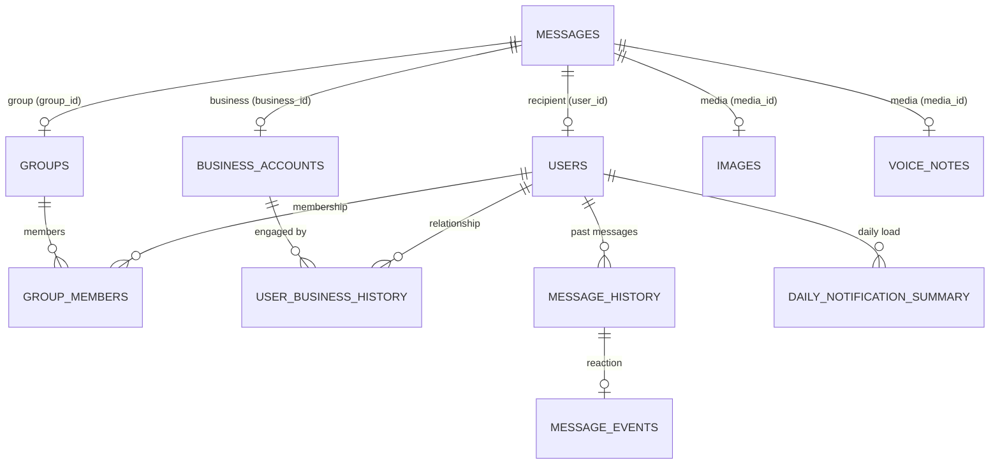

# DATASET_ANALYSIS.md

## 1. File Inventory (13 CSVs + media/)

| File | PK | Rows | Purpose |
| :--- | :--- | :--- | :--- |
| `messages.csv` | `message_id` | 110 | Incoming messages to classify (87 text, 15 image, 8 voice). |
| `output.csv` | `message_id` | 110 | Blank submission template. Must match `messages.csv` 1-to-1. |
| `sample_messages.csv` | `message_id` | 30 | Solved examples for format/style reference. Zero overlap with `messages.csv`. |
| `users.csv` | `user_id` | 54 | Recipient profiles: quiet hours, engagement stats, report counts. |
| `groups.csv` | `group_id` | 23 | Group metadata: name, type, member/admin counts, activity. |
| `group_members.csv` | `(group_id, user_id)` | 401 | Per-user group relationship: role, activity, mute state. |
| `business_accounts.csv` | `business_id` | 110 | Business profiles: brand, verification, domains, report counts. |
| `user_business_history.csv` | `(user_id, business_id)` | 106 | Per-user business relationship: why they know the account, promo consent. |
| `message_history.csv` | `message_id` | 412 | Past messages (evidence candidates). Zero overlap with `messages.csv`. |
| `message_events.csv` | `(user_id, message_id)` | 412 | User reactions to past messages: opened, replied, dismissed, muted, reported. |
| `images.csv` | `image_id` | 20 | Maps image IDs to file paths (`media/images/*.jpg`). |
| `voice_notes.csv` | `voice_note_id` | 13 | Maps voice note IDs to file paths (`media/audio/*.mp3`). |
| `daily_notification_summary.csv` | `(user_id, date)` | 756 | Daily notification volume and dismissal rates per user. |

All FK references verified: every `user_id`, `group_id`, `business_id`, `media_id` in `messages.csv` resolves to its target table. All 15 image files and 8 voice files exist on disk.

---

## 2. Entity-Relationship Linkage

---

## 3. Table Schemas & Decision Signals

### 3.1 `messages.csv` (the target)
| Column | Type | Nullable | FK / Notes |
| :--- | :--- | :--- | :--- |
| `message_id` | String | No | PK → maps to `output.csv` |
| `user_id` | String | No | FK → `users.csv` (recipient) |
| `conversation_type` | `personal`/`group`/`business` | No | Determines which context tables to join |
| `group_id` | String | Yes | FK → `groups.csv` (only when group) |
| `business_id` | String | Yes | FK → `business_accounts.csv` (only when business) |
| `sender_user_id` | String | Yes | FK → `users.csv` (only for personal/group) |
| `created_at` | Timestamp | No | Compare against user's `do_not_disturb_window` |
| `message_text` | String | Yes | Empty for voice messages. Untrusted — may contain scam text or prompt injection |
| `media_type` | `image`/`voice`/empty | Yes | Determines if OCR or ASR is needed |
| `media_id` | String | Yes | FK → `images.csv` or `voice_notes.csv` |
| `forwarded_count` | Integer | No | Context signal, never directly coupled to action |

### 3.2 `users.csv` (recipient profile)
| Column | Signal |
| :--- | :--- |
| `do_not_disturb_window` | Quiet hours (e.g., `22:00-07:00`). 8 messages in `messages.csv` arrive during DND. |
| `notifications_dismissed_30d` | High = notification fatigue. User swipes away alerts without opening. Lean toward `digest` for borderline cases. |
| `messages_reported_30d` | High = low tolerance for spam/scams. |

### 3.3 `groups.csv` + `group_members.csv` (two-table group architecture)

**Why two tables?** `groups.csv` describes the group itself (1 row per group). `group_members.csv` describes each user's relationship with that group (many rows per group).

**`groups.csv`** — what the group is:
- `group_type`: 20 types (e.g., `society`, `school_group`, `coworker`, `family`, `friends`, `marketplace`). Society/school/coworker groups have higher operational urgency.
- `admin_count`, `member_count`, `messages_30d`: Group size and activity level.

**`group_members.csv`** — how a specific user relates to the group:
- `role` (`admin`/`member`): If the sender is `admin` in a high-importance group, their messages carry more weight.
- `group_muted_by_user` (0/1): If 1, user muted the group. Casual content → respect mute. Urgent admin content → may override.
- `messages_sent_30d`, `replies_sent_30d`: How active the user is in this group.

**Key: multiple admins and members per group.** A group with `admin_count=3` has 3 rows with `role=admin` in `group_members.csv`.

### 3.4 `business_accounts.csv` + `user_business_history.csv` (two-table business architecture)

**Why two tables?** `business_accounts.csv` describes the business globally (trust/scam signals). `user_business_history.csv` describes a specific user's relationship with that business (relevance/consent).

**`business_accounts.csv`** — who the business is:
- `verified` (0/1): WhatsApp verification status.
- `official_domain` vs `domain_used_by_sender`: Mismatch = scam signal. Example: `business_041` claims to be PhonePe (`phonepe.com`) but sends from `phonepe-rewards.in`, with `verified=0`, `domain_used_by_sender_age_days=7`, and `user_reports_30d=62`.
- `category`: 40 business categories (e.g., `bank`, `ecommerce`, `payments`, `healthcare`).

**`user_business_history.csv`** — how the user relates to the business:
- `why_user_knows_account`: 89 descriptive strings (e.g., `recent_grocery_delivery`, `active_bank_account`). Treat semantically — new values may appear in hidden test data.
- `allows_promotions` (0/1) and `promotions_opted_out_at`: Consent boundary. `0` or opted-out → promotional messages must be `mute`.
- `messages_dismissed_30d`, `messages_opened_30d`: Engagement level.

### 3.5 `message_history.csv` + `message_events.csv` (evidence tables)
- `message_history.csv` has the same 11-column schema as `messages.csv`. Stores 412 past messages — zero overlap with current messages.
- `message_events.csv` maps each past message to user reactions: `message_opened`, `message_replied`, `notification_dismissed`, `muted_after_message`, `message_reported`, `reaction_time_minutes`.
- **Evidence rule:** When referencing historical evidence in `output.csv`, IDs must come from `message_history.csv`. Any proposed ID must be validated to actually exist.

---

## 4. Runtime Join Sequence

For each message M in `messages.csv`:

1. **User profile** → `users.csv` by `M.user_id` (get DND, engagement stats)
2. **Context** (by `conversation_type`):
   - Group → `groups.csv` by `M.group_id` + `group_members.csv` for sender role and recipient mute state
   - Business → `business_accounts.csv` by `M.business_id` + `user_business_history.csv` for relationship and consent
   - Personal → `users.csv` by `M.sender_user_id`
3. **Media** → if `media_type=image`, get path from `images.csv`; if `voice`, from `voice_notes.csv`
4. **History** → `message_history.csv` filtered by same user/sender/business + `message_events.csv` for past reactions

---

## 5. Key Decision Signals

1. **Sender authority.** Admin in society/school/coworker group + operational content → strong `notify` signal.
2. **Scam signature.** `verified=0` + domain mismatch + high reports + OTP/PIN language → `mute`/`scam`.
3. **Promotional consent.** `allows_promotions=0` or opted out → `mute`/`promotion`.
4. **Forwarded + generic content.** High `forwarded_count` + blessing/health chain → `mute`/`greeting` or `mute`/`forward`. But forwarded operational content from authority → may be `notify`.
5. **Notification fatigue.** High `notifications_dismissed_30d` → lean toward `digest` for borderline cases.
6. **DND window.** Message arrives during quiet hours → low-priority content leans `digest`, urgent content stays `notify`.
7. **Muted group override.** User muted group but admin posts urgent notice → urgency may override mute.
8. **Personalization.** Same message text, same group — different action for different users based on their individual profile and preferences.

---

## 6. Enum Vocabulary Reference

### 6.1 Output Enums (from `problem_statement.md` — strict contract)
| Column | Values |
| :--- | :--- |
| `action` | `notify`, `digest`, `mute` |
| `message_type` | `personal`, `urgent`, `event`, `payment`, `business_update`, `promotion`, `greeting`, `forward`, `spam`, `scam`, `unknown` |

### 6.2 Input Enums (observed in dataset — treat semantically, not as hard rules)
| Table | Column | Count | Values |
| :--- | :--- | :--- | :--- |
| `messages.csv` | `conversation_type` | 3 | `business`, `group`, `personal` |
| `messages.csv` | `media_type` | 2+empty | `image`, `voice` |
| `group_members.csv` | `role` | 2 | `admin`, `member` |
| `groups.csv` | `group_type` | 20 | `alumni`, `book_club`, `caregiving`, `college_faculty`, `college_students`, `coworker`, `dance_class`, `extended_family`, `family`, `finance_help`, `friends`, `investment_tips`, `local_food`, `marketplace`, `real_estate`, `safety`, `school_group`, `society`, `sports`, `tech_community` |
| `business_accounts.csv` | `category` | 40 | `airline`, `bank`, `beauty`, `cashback_rewards`, `cinema`, `cloud_security`, `credit_card`, `ecommerce`, `ecommerce_delivery`, `education`, `events`, `fashion`, `finance`, `fintech`, `fitness_wellness`, `food_delivery`, `grocery`, `grocery_delivery`, `healthcare`, `healthcare_product`, `home_services`, `hotel`, `insurance`, `logistics`, `marketplace`, `payments`, `quick_commerce`, `real_estate`, `restaurant_dining`, `retail`, `ride_booking`, `rides`, `security`, `streaming`, `telecom`, `traffic_challan`, `travel`, `utilities`, `vehicle_insurance`, `vehicle_service` |
| `user_business_history.csv` | `why_user_knows_account` | 89 | Semantic strings. Must not be hardcoded — new values may appear in hidden test data. |

**Design note:** Output enums (`action`, `message_type`) are strict contracts — our system must never emit a value outside this list. Input enums (`group_type`, `category`, `why_user_knows_account`) are feature values — our system must handle unseen values gracefully.
