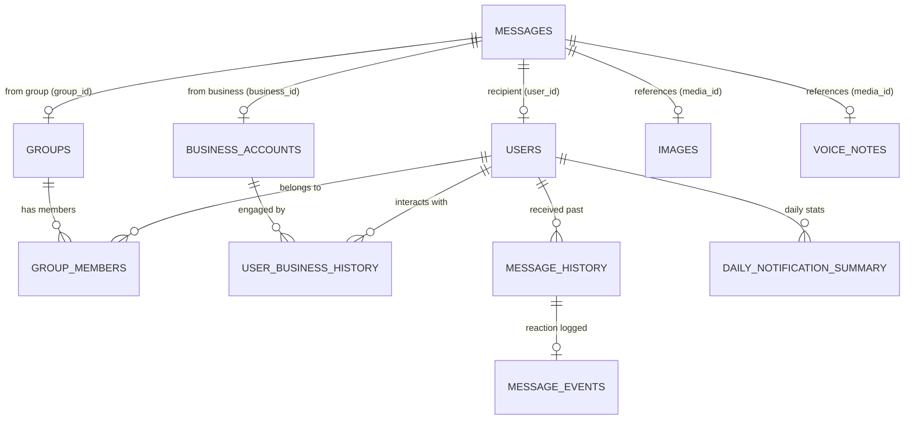

# 📊 DATASET_ANALYSIS.md — Comprehensive Schema, Attribute & Linkage Reference
**Document Scope:** Complete Relational Schema, Attribute Dictionary & Entity-Relationship Linkages  
**Target Dataset:** HackerRank Orchestrate — Message Notification Router (`dataset/`)  
**Methodology:** Principal Data & Systems Architecture  

---

## Executive Summary

The `dataset/` directory contains **13 CSV files** and a structured **media folder** (`dataset/media/`). This document maps the complete relational schema, table-by-table column attributes, primary/foreign key linkages, and critical empirical signals required by the Message Notification Router to evaluate incoming WhatsApp messages.

---

## 1. Complete Dataset File Inventory

| File Name | Primary / Unique Key(s) | Entity Type | Purpose / Description |
| :--- | :--- | :--- | :--- |
| **`messages.csv`** | `message_id` | Core Evaluation Target | 265 incoming multimodal messages requiring prediction. |
| **`output.csv`** | `message_id` | Deliverable Template | Submission template matching the 265 rows of `messages.csv`. |
| **`sample_messages.csv`** | `message_id` | Solved Ground Truth | 71 solved example rows with expected columns and reasons. |
| **`users.csv`** | `user_id` | Recipient Profile | Notification preferences, quiet hours (`do_not_disturb_window`), 30-day activity. |
| **`groups.csv`** | `group_id` | Group Metadata | Group name, type (`family`, `society`, `school_group`, etc.), member counts, activity. |
| **`group_members.csv`** | `(group_id, user_id)` | User-Group Relation | User's role (`admin`, `member`), read/reply stats, and `group_muted_by_user` flag. |
| **`business_accounts.csv`** | `business_id` | Sender Business Profile | Brand identity, verification status, official vs. sender domain, report counts. |
| **`user_business_history.csv`** | `(user_id, business_id)` | User-Business Relation | Relationship type (`recent_grocery_delivery`, etc.), `allows_promotions`, opt-outs. |
| **`message_history.csv`** | `message_id` | Historical Evidence | Past messages received by users, serving as evidence candidates. |
| **`message_events.csv`** | `(user_id, message_id)` | Historical Reactions | User engagement with historical messages (opened, replied, muted, reported). |
| **`images.csv`** | `image_id` | Image Media Index | Maps `image_id` to relative filesystem paths (`media/images/*.jpg`). |
| **`voice_notes.csv`** | `voice_note_id` | Audio Media Index | Maps `voice_note_id` to relative filesystem paths (`media/audio/*.mp3`). |
| **`daily_notification_summary.csv`** | `(user_id, date)` | User Load Summary | Daily notification volume and dismissal rates per user. |

---

## 2. Entity-Relationship (ER) & Linkage Architecture

The incoming message in `messages.csv` sits at the center of the relational graph. Below is the exact foreign key linkage map across all 13 tables:



---

## 3. Table-by-Table Schema & Attribute Specifications

### 3.1 Core Target Table: `messages.csv`
*The incoming stream of messages requiring routing decisions.*

| Column | Data Type | Nullable? | Linkage / Foreign Key | Description & Decision Significance |
| :--- | :--- | :--- | :--- | :--- |
| `message_id` | String | No | **PK** (`output.csv.message_id`) | Unique message identifier. |
| `user_id` | String | No | **FK** → `users.user_id` | The recipient user whose preferences dictate routing. |
| `conversation_type` | Enum (`personal`, `group`, `business`) | No | Discriminator | Controls whether to lookup `group_id`, `business_id`, or `sender_user_id`. |
| `group_id` | String | Yes | **FK** → `groups.group_id` | Present if `conversation_type=group`. |
| `business_id` | String | Yes | **FK** → `business_accounts.business_id` | Present if `conversation_type=business`. |
| `sender_user_id` | String | Yes | **FK** → `users.user_id` (sender) | Present if `conversation_type` is `personal` or `group`. |
| `created_at` | Timestamp | No | Temporal | ISO timestamp of message arrival; compared against user quiet hours. |
| `message_text` | String | Yes | N/A | Text content (empty for voice notes); evaluated for keywords, urgency, and scams. |
| `media_type` | Enum (empty, `image`, `voice`) | Yes | Discriminator | Indicates if media processing (OCR / audio transcription) is required. |
| `media_id` | String | Yes | **FK** → `images.image_id` or `voice_notes.voice_note_id` | Linked media ID if `media_type` is present. |
| `forwarded_count` | Integer | No | N/A | Number of times forwarded; high counts on greetings indicate `mute`/`greeting`. |

---

### 3.2 User & Context Profiles

#### `users.csv` (Recipient Profile)
| Column | Type | Description |
| :--- | :--- | :--- |
| `user_id` | String (**PK**) | Unique recipient ID. |
| `do_not_disturb_window` | String (`HH:MM-HH:MM`) | User quiet hours (e.g., `22:00-07:00`). Low-priority messages arriving in this window should be `digest` or `mute`. |
| `messages_opened_30d` | Integer | Total opens in last 30 days (baseline engagement). |
| `messages_replied_30d` | Integer | Total replies in last 30 days. |
| `notifications_dismissed_30d` | Integer | High dismissal rate indicates sensitivity to notification fatigue. |
| `messages_reported_30d` | Integer | High report rate indicates intolerance for spam/scams. |

#### `groups.csv` & `group_members.csv` (Group Context)
| Table | Column | Linkage | Description |
| :--- | :--- | :--- | :--- |
| `groups.csv` | `group_type` | Enum | `family`, `society`, `school_group`, `coworker`, `marketplace`, `friends`, `alumni`, `extended_family`. School/society admin circulars have high urgency. |
| `groups.csv` | `admin_count` / `member_count` | Integer | Size and admin structure of the group chat. |
| `group_members.csv` | `role` | Enum (`admin`, `member`) | **Critical Signal:** Messages from an `admin` in a `society` or `school_group` are strong candidates for `notify`/`urgent` or `notify`/`event`. |
| `group_members.csv` | `group_muted_by_user` | Integer (0/1) | **Critical Signal:** If `1`, the user muted this group. Regular chat is `mute` or `digest`, UNLESS there is a direct `@mention` or urgent admin notice. |

#### `business_accounts.csv` & `user_business_history.csv` (Business Context)
| Table | Column | Linkage | Description |
| :--- | :--- | :--- | :--- |
| `business_accounts.csv` | `verified` | Integer (0/1) | Whether WhatsApp verified the brand. |
| `business_accounts.csv` | `official_domain` vs. `domain_used_by_sender` | Strings | **Scam Signal:** In row 10 (`business_041`), official domain is `phonepe.com`, but sender uses `phonepe-rewards.in` with `verified=0` and 62 user reports. This mismatch signals `scam`. |
| `user_business_history.csv` | `why_user_knows_account` | Enum | e.g., `recent_grocery_delivery`, `active_bank_account`, `confirmed_travel_booking`. Validates legitimate transaction updates (`notify`/`business_update`). |
| `user_business_history.csv` | `allows_promotions` / `promotions_opted_out_at` | Integer / Timestamp | **Promotional Guardrail:** If `allows_promotions=0` or opted out, promotional messages must be `mute`. |

---

### 3.3 Historical Evidence & Engagement

#### `message_history.csv` & `message_events.csv`
* `message_history.csv` shares the exact same 11-column schema as `messages.csv`. It stores prior messages received by users.
* `message_events.csv` maps `(user_id, message_id)` to behavioral reactions:
  * `message_opened` (0/1), `message_replied` (0/1), `reaction_time_minutes` (Integer)
  * `notification_dismissed` (0/1), `muted_after_message` (0/1), `message_reported` (0/1)
* **Evidence Linkage Rule:** When our router classifies an incoming message as `mute` (due to prior ignored spam) or `notify` (due to prior active engagement), `evidence_message_ids` in `output.csv` must reference the exact `message_id` from `message_history.csv` where the user exhibited that behavior.

---

## 4. Runtime Join & Evaluation Playbook

When the Message Notification Router evaluates an incoming row $M$ from `messages.csv`, it must execute the following structured joins:

```text
┌───────────────────────────────────────────────────────────────────────┐
│ 1. PROFILE JOIN: Lookup user U in `users.csv`                         │
│    • Extract `do_not_disturb_window` and compare against M.created_at │
├───────────────────────────────────────────────────────────────────────┤
│ 2. CONTEXT JOIN (by conversation_type):                               │
│    • GROUP: Lookup G in `groups.csv` & member record in               │
│      `group_members.csv` (check `role` of sender & `group_muted`)     │
│    • BUSINESS: Lookup B in `business_accounts.csv` (check `verified`, │
│      domain match, reports) & `user_business_history.csv` (opt-out)   │
├───────────────────────────────────────────────────────────────────────┤
│ 3. MEDIA RESOLUTION:                                                  │
│    • If M.media_type='image' → get path from `images.csv`             │
│    • If M.media_type='voice' → get path from `voice_notes.csv`        │
├───────────────────────────────────────────────────────────────────────┤
│ 4. HISTORICAL EVIDENCE JOIN:                                          │
│    • Query `message_history.csv` for same sender/business/topic       │
│    • Join with `message_events.csv` to see if user previously         │
│      opened, ignored, muted, or reported similar messages             │
└───────────────────────────────────────────────────────────────────────┘
```

---

## 5. Key Empirical Decision Signals Summary

1. **The Trusted Admin Override:** A message from a sender where `group_members.role = 'admin'` in a `society` or `school_group` chat offering time-sensitive operational instructions is classified as `notify` / `urgent` or `notify` / `event`, even if `group_muted_by_user = 1`.
2. **The Brand Scam Signature:** Any business message where `verified = 0` and `official_domain != domain_used_by_sender` (or asking for OTPs/PINs via external links) must be classified as `mute` / `scam`.
3. **The Promotional Consent Boundary:** Any promotional message from a business where `user_business_history.allows_promotions = 0` or `promotions_opted_out_at` is not null must be classified as `mute` / `promotion` or `mute` / `spam`.
4. **The Chain Forward Signature:** Messages in group chats with `forwarded_count >= 5` containing generic blessings or health chain text are classified as `mute` / `greeting` or `mute` / `forward`.

---

## 6. Complete Enum & Vocabulary Catalog (100% Exhaustive Table of All Enums)

Below is an exhaustive, mathematically complete catalog of every enum column across the entire schema and its observed/allowed vocabulary:

### 6.1 Output Specification Vocabularies (`output.csv` & `problem_statement.md`)
| Enum Column | Complete Allowed / Observed Values | Engineering Notes |
| :--- | :--- | :--- |
| `action` | `notify`, `digest`, `mute` | **3 allowed values** (100% observed in `sample_messages.csv`). |
| `message_type` | `personal`, `urgent`, `event`, `payment`, `business_update`, `promotion`, `greeting`, `forward`, `spam`, `scam`, `unknown` | **11 allowed values** (`payment` is MISSING from sample data; must be explicitly encoded in Pydantic schema so it is not dropped). |

### 6.2 Input Message & Context Table Enums (`dataset/*.csv`)
| Table Name | Enum Column | Total Values | Exhaustive List of Observed Values |
| :--- | :--- | :--- | :--- |
| **`messages.csv`** | `conversation_type` | 3 | `business`, `group`, `personal` |
| **`messages.csv`** | `media_type` | 2 + empty | `image`, `voice` (or empty string for text messages) |
| **`group_members.csv`** | `role` | 2 | `admin`, `member` |
| **`groups.csv`** | `group_type` | 20 | `alumni`, `book_club`, `caregiving`, `college_faculty`, `college_students`, `coworker`, `dance_class`, `extended_family`, `family`, `finance_help`, `friends`, `investment_tips`, `local_food`, '`marketplace`, `real_estate`, `safety`, `school_group`, `society`, `sports`, `tech_community` |
| **`business_accounts.csv`** | `category` | 40 | `airline`, `bank`, `beauty`, `cashback_rewards`, `cinema`, `cloud_security`, `credit_card`, `ecommerce`, `ecommerce_delivery`, `education`, `events`, `fashion`, `finance`, `fintech`, `fitness_wellness`, `food_delivery`, `grocery`, `grocery_delivery`, `healthcare`, `healthcare_product`, `home_services`, `hotel`, `insurance`, `logistics`, `marketplace`, `payments`, `quick_commerce`, `real_estate`, `restaurant_dining`, `retail`, `ride_booking`, `rides`, `security`, `streaming`, `telecom`, `traffic_challan`, `travel`, `utilities`, `vehicle_insurance`, `vehicle_service` |
| **`user_business_history.csv`** | `why_user_knows_account` | 89 | `abandoned_travel_search`, `active_bank_account`, `active_credit_card`, `active_global_bank_account`, `active_payment_wallet`, `active_retail_membership`, `active_sale_subscription`, `active_us_bank_account`, `alumni_event_booking`, `book_adaptation_watchlist`, `business_payment_stack_interest`, `campus_event_registration`, `career_event_registration`, `caregiver_insurance_claim`, `cashback_wallet`, `community_workshop_registration`, `confirmed_travel_booking`, `coupon_membership`, `dance_class_booking`, `dance_event_booking`, `daytime_food_order`, `delivery_expected_today`, `doctor_search`, `education_survey_or_event`, `event_registration`, `fashion_sale_subscription`, `food_promotions_opted_out`, `frequent_delivery_updates`, `frequent_food_orders`, `health_product_order`, `hotel_booking`, `hotel_search`, `ignored_loan_message`, `land_listing_watchlist`, `loan_promotions_opted_out`, `local_event_booking`, `local_food_orders`, `marketplace_style_interest`, `medicine_order`, `monthly_maintenance_payment`, `monthly_mobile_bill`, `monthly_utility_bill`, `movie_or_event_booking`, `music_subscription`, `new_food_delivery_signup`, `office_delivery_order`, `old_credit_card_account`, `old_delivery_order`, `old_retail_coupon_list`, `old_retail_subscription`, `old_sale_subscription`, `old_travel_search`, `prescription_order`, `prescription_refill`, `quick_delivery_orders`, `recent_card_payment`, `recent_delivery_order`, `recent_flight_booking`, `recent_food_order`, `recent_grocery_delivery`, `recent_movie_booking`, `recent_movie_feedback`, `recent_product_purchase`, `recent_return_pickup`, `registered_for_campus_event`, `repair_booking`, `restaurant_reservation`, `ride_booked_today`, `saved_travel_search`, `school_event_registration`, `school_fee_payment`, `security_incident_updates`, `security_webinar_registration`, `society_payment_receipt`, `streaming_subscription`, `student_event_booking`, `tech_webinar_registration`, `trading_account_update`, `traffic_challan_notice`, `travel_card_account`, `travel_package_interest`, `travel_promotions_opted_out`, `upcoming_clinic_appointment`, `vehicle_insurance_renewal`, `vehicle_service_booking`, `vendor_payment_account`, `vendor_security_notice`, `weekly_grocery_order`, `work_vendor_payment`, `workshop_registration` |

---

### 6.3 Principal Design Takeaway for Runtime Seams
Because these vocabularies are rich and multi-dimensional (e.g., 40 business categories and 89 relationship types), our router must not rely on brittle hardcoded if/else string matching. Instead:
1. We load these valid enum sets into **Pydantic v2 `Literal` / `Enum` validation contracts** at boot time.
2. We provide the allowed target vocabularies (`action`, `message_type`) to our structured AI sensor so it never hallucinates out-of-vocabulary labels.

